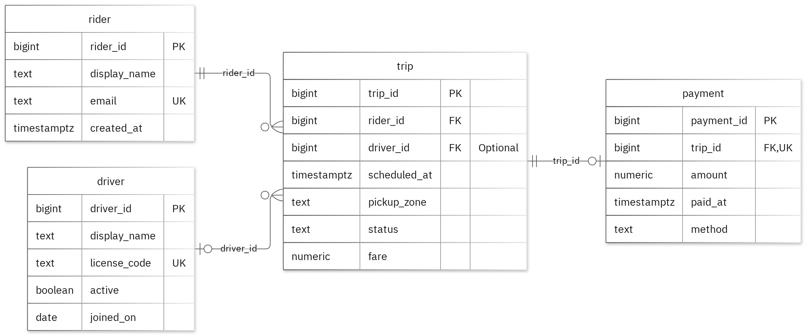

# MIT 8103 Advanced Database Systems

**Ride-hailing / Logistics System** · Theresa Amaechi · Student ID 301918155

## Case study
For this case study, I chose a Ride-Hailing / Logistics System because it reflects the kind of work I see in the logistics industry. I designed a database to help dispatchers manage trip requests, assign drivers to riders, and keep track of the payments generated from completed trips. It also gives operations analysts a clearer way to review trip activity and monitor how much revenue each driver is bringing in.
The database has four main tables: Rider, Driver, Trip, and Payment. Each table stores information relevant to its purpose, and the relationships between them help keep the data consistent and organised.
The main operations supported by the system are registering riders and drivers, creating trip requests, assigning drivers, updating trip status, and recording payments for completed journeys.
My goal was to make trip management easier, improve coordination between riders and drivers, and help the operations team keep accurate records of trips and payments.

## Portfolio 1: Database Design and Modelling
I designed the relational database using four tables, with each one serving a specific purpose. I used primary keys to uniquely identify records and foreign keys to connect related information across the tables. I also added check constraints to make sure the data entered follows the required rules.
One of the rules I implemented ensures that a driver cannot be assigned to more than one active trip at a time. This is done using a partial unique constraint on `driver_id` for trips with a status of `assigned` or `in_progress`.
I also showed how the sample data meets the requirements of 1NF, 2NF, and 3NF. To test the database, I ran 34 intentionally incorrect insert statements. All of them were rejected, and the valid sample records remained unchanged.

Figure 1. Tables, keys and relationships. PK: primary key; FK: foreign key; UK: unique value.

<!-- PAGE BREAK -->

## Portfolio 2: Query Processing and Optimisation
I tested the sample records using four SQL queries. The join query returned two results, including Blake Rider paired with Casey Driver.
For the index performance test, I created 20,000 separate performance records and compared the lookup times before and after adding the index. The median time dropped from 1.071 ms to 0.234 ms. Both tests returned the same results, and the execution plan confirmed that the new index was being used.
These results show that the index improved the lookup speed in my test, although the timings are specific to the query and the environment I used.

## Portfolio 3: Transactions and Concurrency
I used a temporary counter on trip to test COMMIT, ROLLBACK, and READ COMMITTED isolation. The uncommitted update stayed hidden from the other session, and ROLLBACK restored the earlier committed value. Without locking, two increments left the counter at 2. With `SELECT FOR UPDATE`, Session B waited for Session A and the final value was 3.
This was a useful exercise because it showed how transaction timing and locking can affect the final result in a real database.

## Portfolio 4: NoSQL and Advanced Data Models
I used a MongoDB collection called `trip_events` to store event records for my case study. I added two sample events and tested them with four queries, all of which returned the expected results. I also tested validation rules, and the system rejected an invalid date format and a duplicate event ID.
I used embedded snapshots to keep related information together within each event. The `details` field can also hold different types of information depending on the event being recorded. The events used in this test are fictional, while PostgreSQL remains responsible for enforcing the main relational database rules.

## Repository and evidence

https://github.com/tamaechi8155-rgb/Amaechi_Theresa_301918155

The portfolio folders contain the SQL and JavaScript files, explanations, query plans, result tables, and screenshots that support the work.

<!-- PAGE BREAK -->

## Portfolio 5: Distributed and Cloud Database Exercise
I proposed using three MongoDB replica members in separate failure zones to improve availability. I explained how primary elections, majority acknowledgement, secondary lag, and sharding would work for `trip_events`. Replication helps keep the system available, while backups support data recovery. PostgreSQL also needs a separate availability plan.
This was only a proposed design, and I did not deploy or test a live replica set or failover. It was more about showing how the system could be designed for resilience and recovery in a distributed environment.

## Individual reflection
I placed the rider, driver, trip, and payment in separate tables to avoid repeating information. I also added a rule to ensure that a driver can only have one active trip at a time. Testing the constraints helped confirm that the required values and relationships were being maintained correctly.
The two-session test was especially useful because it showed that both sessions could read the same value before updating it. Locking the row before reading helps prevent this problem and makes sure both updates are saved correctly. The index test also showed me why checking the execution plan matters, because two queries can return the same result while still requiring very different amounts of database work.

## AI-use declaration
I used GitHub Copilot and the portfolio generator to help prepare the database model, scripts, and explanations. The generator ran the PostgreSQL and MongoDB exercises, checked the outputs, and captured the result images. I remain responsible for reviewing, validating, and explaining the work submitted.

## References

- [PostgreSQL: constraints](https://www.postgresql.org/docs/17/ddl-constraints.html)
- [PostgreSQL: EXPLAIN](https://www.postgresql.org/docs/17/using-explain.html)
- [PostgreSQL: isolation](https://www.postgresql.org/docs/17/transaction-iso.html)
- [PostgreSQL: row locks](https://www.postgresql.org/docs/17/explicit-locking.html)
- [MongoDB: data modelling](https://www.mongodb.com/docs/manual/data-modeling/)
- [MongoDB: replication](https://www.mongodb.com/docs/manual/replication/)
- [MongoDB: sharding](https://www.mongodb.com/docs/manual/sharding/)
- [Mermaid: ER diagrams](https://mermaid.js.org/syntax/entityRelationshipDiagram.html)

